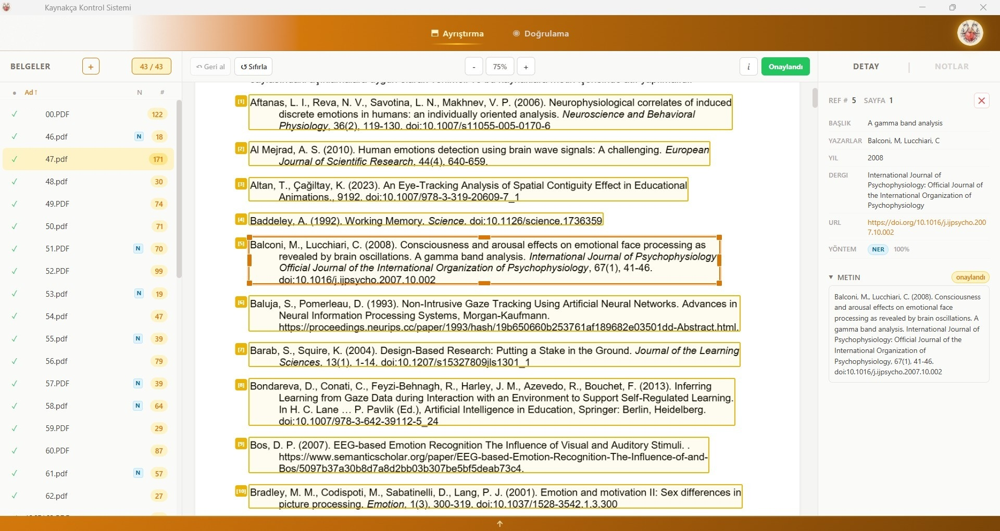
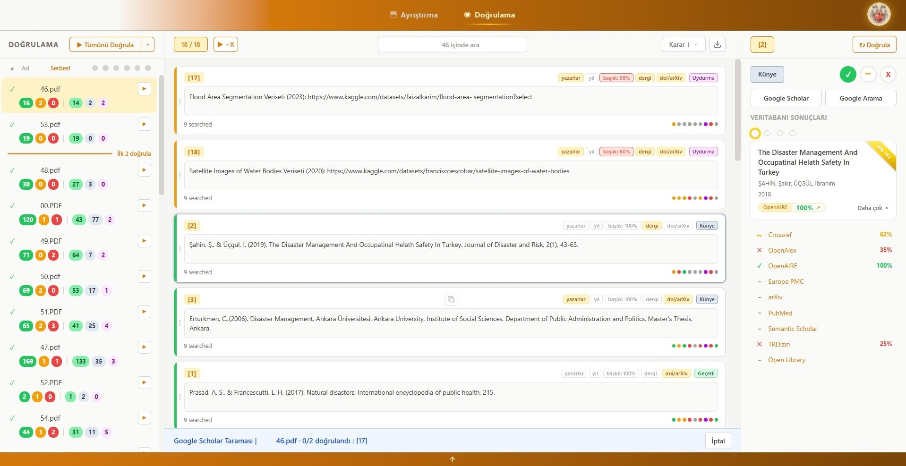

# Atf-ı Memnu: Kaynakça Kontrol Sistemi


A Windows desktop app for academic PDFs. It extracts each PDF's reference list and verifies every source against a panel of scholarly databases. It also covers reviewing and correcting the detected sources, annotating the PDF, and exporting an annotated copy or a verification report.

This is the **Python + native WebView2** edition of the app, ported from the [Electron version](https://github.com/temasictfic/Atf-I-Memnu). The UI, features and data are the same. What changed underneath, and why, is in [PORTING_REPORT.md](PORTING_REPORT.md).

## Screens

| Parsing | Verification |
|---|---|
|  |  |

## What it does

1. **Ingest.** Pick a folder or drop PDFs. pdf.js parses them and finds the reference section; each source becomes an editable box.
2. **Review.** Draw, edit, merge and reorder source boxes, then approve.
3. **Extract fields (NER).** A fine-tuned ONNX citation parser (RoBERTa, INT8) pulls out title, authors, year, venue, DOI, etc.
4. **Verify.** Approved sources are searched in Crossref, OpenAlex, OpenAIRE, Europe PMC, arXiv, PubMed, TR Dizin, Open Library, Semantic Scholar, BASE and (optionally) Web of Science, with results streaming in live. A built-in **Google Scholar** panel re-checks sources the APIs couldn't confirm, with CAPTCHA hand-off.
5. **Annotate and report.** Add highlights and callouts (or generate them from the results), then export an annotated PDF or a verification report.

The UI is fully localized in **Turkish** and **English**. Scoring and decision rules are described in [SCORING.md](SCORING.md).

## Architecture

```
KaynakcaKontrolSistemi.exe   (one Python process, PyInstaller one-folder build)
├─ pywebview window ── system WebView2 runtime (Microsoft Edge)
│   ├─ main view: React UI (frontend/), served from http://127.0.0.1:<port>/
│   └─ <atfi-webview> guest views: native WebView2 controls for the Scholar
│      panel and the hidden Scholar scanner (persistent "scholar-panel" profile)
├─ FastAPI backend (backend/) on a background thread, same origin as the UI
│   ├─ /api/*      parsing cache, verification, settings, WebSocket progress
│   └─ /__host/*   desktop bridge: dialogs, PDF read/write, updater, native views
└─ atfi_app/       host: window, bridge, updater, one-time NER model download
```

- **No Electron, no bundled Chromium, no Node at runtime.** Node is only used to build the React UI. WebView2 is part of Windows 10/11; the installer adds it if it's missing.
- **The Google Scholar panel is real Microsoft Edge**, not Electron posing as Chrome. That avoids the fingerprint mismatches that trip Cloudflare Turnstile and similar checks.
- **Security:** the API binds to loopback only and requires a per-launch token. A Host-header allow-list and a WebSocket Origin check block other local web pages and DNS rebinding.
- **NER model:** the 125 MB model is **downloaded once** into `%LOCALAPPDATA%\atfi-memnu-app\models`, by the installer or by the app on first launch, and reused by every update. Releases stay small.
- **Data:** settings, API keys and caches live in `%APPDATA%\atfi-memnu-app\output`, the same folder as the Electron edition, so upgrading keeps everything.

## Install

Download `Kaynakca-Kontrol-Sistemi-Setup-<version>.exe` from [Releases](https://github.com/temasictfic/ATF-I-MEMNU-NEV/releases). It's a per-user install and needs no admin rights. A portable zip is also published; it doesn't self-update.

## Development

Requirements: Python 3.14 with [uv](https://docs.astral.sh/uv/) (pinned in `.python-version`), Node 22.12+ (CI uses Node 26 LTS), Inno Setup 6.5+ for the installer. Windows is needed for the real window; everything else also runs on Linux and macOS.

```bash
cd frontend && npm ci && npm run build && cd ..
```

```bash
uv sync
```

```bash
uv run python scripts/fetch_model.py
```

Run the desktop app (Windows):

```bash
uv run python -m atfi_app
```

Run the same UI and backend in a regular browser (any OS). Native dialogs are scripted through `ATFI_DEV_PICK_PDFS` / `ATFI_DEV_PICK_DIR` / `ATFI_DEV_SAVE_PATH`, and the Scholar panel falls back to an iframe:

```bash
uv run python -m atfi_app --dev-browser --port 8765 --token devtoken
```

For UI hot reload, run Vite against that backend:

```bash
cd frontend && VITE_ATFI_PORT=8765 VITE_ATFI_TOKEN=devtoken npm run dev
```

### Tests

```bash
uv run pytest
```

```bash
uv run ruff check atfi_app backend tests
```

```bash
cd frontend && npm run typecheck
```

UI smoke test (headless Chromium against `--dev-browser`; see the header of the file):

```bash
node tests/ui/dev-browser-smoke.mjs
```

On Windows, `KaynakcaKontrolSistemi.exe --smoke-test shot.png` launches the real app. It checks the UI, the backend and a native guest WebView2 view, saves a screenshot and exits. CI runs it on every push.

### Build and release

```powershell
./scripts/build.ps1
```

`build.ps1` produces the PyInstaller one-folder app, the Inno Setup installer, a portable zip and `SHA256SUMS` in `packaging/dist/`.

- **Releasing:** run **Build and Release** from the Actions tab on `main`. It tags `v<atfi_app/version.py>` and publishes the installer, the portable zip and `SHA256SUMS`. Pushing a matching `v*` tag does the same. The in-app updater reads the latest GitHub release and verifies the installer against `SHA256SUMS`.
- **The repository must be public** for end users to receive updates and the NER model. Installers and the app download anonymously, so assets in a private repository return 404. Until then, the model falls back to the mirror in `model_manifest.json` and update checks fail silently.
- **Model release:** run the **Publish NER model** workflow once, and again only when the model changes. It uploads the model files to the `model-citation-ner-int8-v1` release, the primary source in `atfi_app/model_manifest.json`; until then the original repository is used as a mirror. To ship a new model, update the manifest (version, hashes, URLs) and run the workflow again.

## Repository layout

| Path | What |
|---|---|
| `atfi_app/` | Desktop host: entry point, backend host, `/__host` bridge, updater, model manager, native WebView2 layer (`native/`) |
| `backend/` | FastAPI app: verifiers, NER, scoring, caches (`backend/training/` has the model training pipeline) |
| `frontend/` | React + TypeScript UI (Vite) |
| `packaging/` | PyInstaller spec, Inno Setup script |
| `scripts/` | Build and release helpers |
| `docs/` | GitHub Pages download site |
| `diagnostics/` | Network diagnostic scripts for end users |
